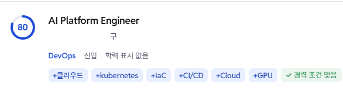
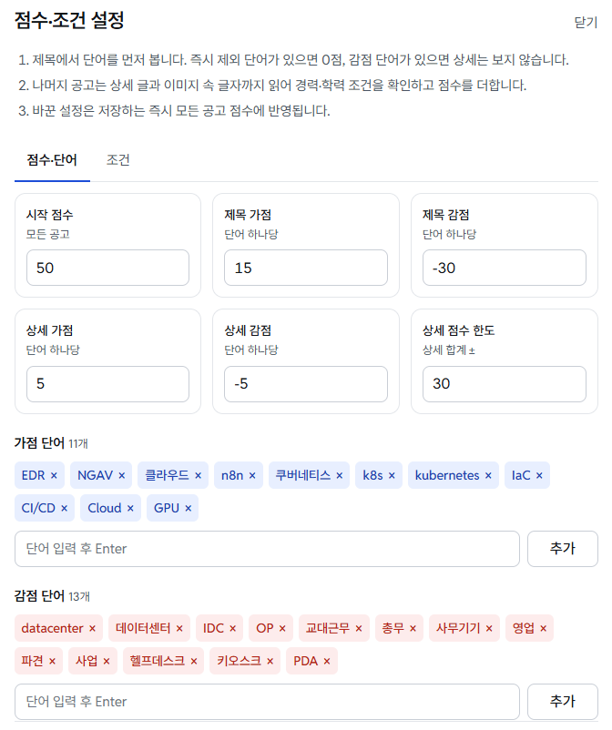

<div align="center">

# k-jobscore

**공고를 열어 보기 전에, 지원할 수 있는 공고인지 먼저 알려 줍니다.**

원티드 · 사람인 · 잡코리아 · 리멤버 공고를 본문·이미지까지 읽고, 내 기준으로 점수를 매깁니다.



[빠른 시작](#빠른-시작) · [화면 읽는 법](#화면-읽는-법) · [설정](#설정) · [AI 판단](#ai-판단-선택)

</div>

## 왜 필요한가

이력서에 맞는 공고를 **추천**해 주는 서비스는 많습니다.
정작 시간이 드는 건, 공고를 하나씩 열어 정말 지원할 수 있는지 **확인**하는 일입니다.

| 목록에 보이는 것 | 열어 보면 |
|---|---|
| 학력 무관 | 본문 이미지에 "4년제 학사 이상" |
| 신입 | 자격요건에 "관련 경력 3년 이상" |
| 인프라 엔지니어 | 데이터센터 교대근무, 파견 |

k-jobscore는 이 확인을 대신해, **정말 지원할 수 있고 지원하고 싶은 공고**만 남깁니다.

## 특징

- **이미지까지 읽기** — 상세 본문과 이미지 속 글자(OCR)에서 실제 요구조건을 찾습니다.
- **조건만 골라 판정** — 우대사항, 수습·연봉 안내, "이에 준하는 경험" 줄은 빼고 자격요건으로만 경력·학력을 판단합니다.
- **내 기준으로 점수** — 가점·감점·즉시 제외·필수 단어와 점수를 직접 정하고, 바꾸면 바로 반영됩니다.
- **근거가 보이는 점수** — 어떤 단어로 몇 점이 붙었는지 칩으로 보여 줍니다.
- **내 컴퓨터에서만** — 모은 공고는 로컬에만 두고, 화면에는 원문 링크만 보여 줍니다.

## 화면 읽는 법

| 공고 | 왜 이 점수인가 |
|---|---|
|  | 상세에서 클라우드·k8s **+10**, 사업 **−5** → **55점**<br>경력·학력 조건 확인됨 |
|  | 제목에 데이터센터·IDC **−60** → **0점**<br>제목에 감점 단어가 있으면 상세는 읽지 않음 |

- **파랑 `+` / 빨강 `−`** 가점·감점 단어. 테두리가 있으면 제목에서, 없으면 상세에서 찾은 단어입니다.
- **초록 `✓`** 상세에서 확인한 경력·학력 조건. 맞지 않으면 빨강 `✕`로 표시하고 목록에서 숨깁니다.
- **원 색** 70점↑ 파랑 · 50점↑ 검정 · 30점↑ 주황 · 그 아래 빨강. 점선은 상세 확인 전입니다.

점수 기준과 단어는 화면의 **설정**에서 바꿉니다.



## 빠른 시작

> AI 에이전트(Claude Code · Codex · Gemini CLI)를 쓴다면 이 저장소를 열고 "**k-jobscore 설치해 줘**"라고만 하면 됩니다.

```bash
pip install "k-jobscore[ocr] @ git+https://github.com/wogho/k-jobscore"
k-jobscore init       # 프리셋 고르기: infra-junior / dev-junior / all
k-jobscore collect    # 공고 수집 + 본문·이미지 읽기 + 판정
k-jobscore serve      # 화면 http://127.0.0.1:8765
```

```bash
# 이미지 글자 읽기(OCR)용 — macOS: brew install tesseract tesseract-lang
sudo apt install tesseract-ocr tesseract-ocr-kor
```

- Docker: `docker compose up`
- 정기 실행은 `k-jobscore collect`를 3시간마다 걸어 두면 됩니다.
- 고른 공고는 [career-ops](https://github.com/career-ops-hq/career-ops)로 넘길 수 있습니다: `k-jobscore export --format career-ops`

## 동작 방식

1. **수집** — 사이트별 검색어로 최신 공고를 모읍니다. 이미 본 공고가 많아지면 일찍 멈춥니다.
2. **거르기** — 직무, 목록에 적힌 경력·학력, 고용형태, 지역, 회사로 거릅니다.
3. **제목 판정** — 제목에 감점 단어가 있으면 여기서 끝냅니다.
4. **상세 읽기** — 본문과 이미지 속 글자(OCR)를 읽습니다.
5. **조건 판정** — 자격요건 줄에서 경력·학력·전공 필수를 확인합니다.
6. **점수** — 상세에서 찾은 단어 점수를 더합니다.

## 설정

설정은 `~/.k-jobscore/config.json` 파일 하나입니다. 대부분은 화면의 **설정**에서 바꿀 수 있습니다.

### 단어

| 종류 | 효과 |
|---|---|
| 가점 `plus` | 제목 +15 · 상세 +5 (기본값, 단어마다 바꿀 수 있음) |
| 감점 `minus` | 제목 −30 · 상세 −5. 제목에 있으면 상세는 읽지 않음 |
| 즉시 제외 `veto` | 있으면 0점 |
| 필수 `must` | 제목·상세 어디에도 없으면 0점 |

```jsonc
{"word": "GPU", "kind": "plus", "title": 20, "body": 8}       // 단어별 점수
{"word": ["쿠버네티스", "k8s", "kubernetes"], "kind": "plus"}  // 같은 뜻은 묶어 한 번만
{"word": "교대근무", "kind": "minus", "where": "body"}          // 상세에서만
{"word": "파견", "kind": "veto"}
```

영문 4자 이하(OP, IDC, k8s)는 낱말 단위로만 찾습니다. `DevOps` 안의 `Op`는 감점하지 않습니다.

### 조건

| 항목 | 설명 |
|---|---|
| 내 학력 | 무관 · 고졸 · 초대졸 · 대졸 · 석사 · 박사. 이보다 높은 학력을 **분명히** 요구하면 불일치 |
| 허용 요구 경력 | 이 연수 이하를 요구하는 공고까지 (0 = 신입만) |
| 표기가 없을 때 | 학력·경력 표기 없음, "관련 전공 필수"를 **통과 · 보류 · 제외** 중 선택 |
| 이에 준하는 경험 | "학사 이상 또는 이에 준하는 경험"은 필수로 보지 않음 (끌 수 있음) |
| 거르기 | 직무 · 고용형태(예: 파견) · 지역 · 회사 |

모든 항목과 기본값은 [docs/CONFIG.md](docs/CONFIG.md)에 있습니다.

## AI 판단 (선택)

기본은 꺼져 있고, 규칙만으로 동작합니다. 켜면 AI가 공고를 읽고 **적합도 · 요약 · 지원 전략**을 붙입니다.
AI는 판단만 하고, 점수 계산은 여전히 코드가 합니다.

### 1. 에이전트 모드 — 설정 없음

이 저장소를 Claude Code · Codex · Gemini CLI 같은 AI 에이전트로 열고 이렇게 말합니다.

> k-jobscore 설치하고, 내 조건으로 공고 모아서 판정까지 해 줘

에이전트가 [AGENTS.md](AGENTS.md)를 따라 설치하고, 공고를 받아 직접 판정합니다.

```bash
k-jobscore ai --export todo.json   # 판정할 공고 내보내기
k-jobscore ai --import done.json   # 에이전트가 쓴 판정 넣기
```

### 2. 설치된 AI 명령어 — 키 없음

`claude` · `codex` · `gemini`가 설치돼 있으면 `init` 때 판정에 쓸지 묻습니다. 쓰기로 하면 그 로그인 그대로, 정기 수집 때도 판정합니다.

```bash
k-jobscore init --ai auto
```

구독 사용량을 쓰므로, 규칙 점수가 기준 이상인 공고만 한 번에 정해진 건수까지 보냅니다.

### 3. API 연결

OpenAI 호환(Ollama 포함) · Anthropic. 키는 환경변수 `KJOBSCORE_AI_KEY`에서만 읽습니다.

### 안전장치

- **원문 인용** — 모든 판단에 공고 원문을 인용해야 하고, 원문에 없는 인용은 버립니다.
- **믿지 않는 입력** — 공고 속 지시문은 따르지 않고, 의심되면 화면에 표시합니다.
- **뒤집기 금지** — 즉시 제외, 학력·경력 불일치는 AI가 바꿀 수 없습니다.
- **점수 반영** — 최종 = 규칙 × (1 − 비중) + AI × 비중. 비중을 0으로 두면 의견만 표시합니다.

## 문서

- [docs/CONFIG.md](docs/CONFIG.md) — 설정 전체 항목과 기본값
- [docs/COMPARISON.md](docs/COMPARISON.md) — career-ops · k-skill과의 차이
- [AGENTS.md](AGENTS.md) — AI 에이전트용 설치·판정 안내
- [LEGAL.md](LEGAL.md) — 수집 예절과 책임(개인 구직용, 재배포 금지)

## 감사

[career-ops](https://github.com/career-ops-hq/career-ops)를 출발점으로 한국 채용 환경에 맞게 확장했습니다(MIT, k-jobscore는 공식 프로젝트가 아닙니다).
[k-skill](https://github.com/NomaDamas/k-skill) · [taste-skill](https://github.com/Leonxlnx/taste-skill) · [Tesseract](https://github.com/tesseract-ocr/tesseract)를 참고했습니다. 자세한 내용은 [NOTICE](NOTICE).

MIT License © 2026 wogho
